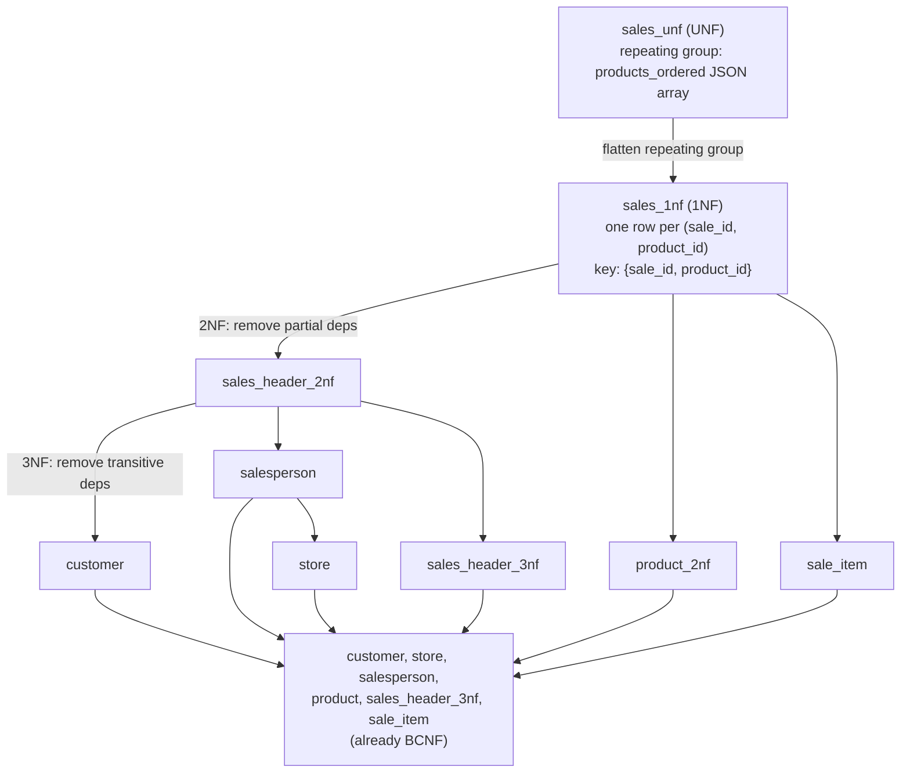

<div align="center">


<table>
<tr><th align="left">Name</th><td>Iqra Khan</td><th align="left">UID</th><td><code>25LBCS3306</code></td></tr>
<tr><th align="left">Experiment No.</th><td>07</td><th align="left">SQL Script</th><td><a href="normalization.sql"></a></td></tr>
<tr><th align="left">Experiment Title</th><td colspan="3">Functional Dependencies and Normalization to BCNF</td></tr>
</table>

</div>


## $\color{#3D405B}{\textsf{Aim}}$

> [!NOTE]
> Given a **denormalized Sales table**, to identify its **functional dependencies (FDs)**, normalize it **step by step from UNF to 1NF, 2NF, 3NF and BCNF**, and verify **lossless join** and **dependency preservation** using SQL.


## $\color{#3D405B}{\textsf{Software Required}}$

- MySQL Server 8.0 or later (`JSON_TABLE`, window-free `EXCEPT`)
- MySQL Workbench or the MySQL command-line client


## $\color{#3D405B}{\textsf{Files}}$

| File | Description |
|---|---|
| [`normalization.sql`](normalization.sql) | UNF sales register, every normalization step, and all verification queries |
| `Exp_7.md` | This lab record |

**How to run:**

```bash
mysql -u root -p -t < normalization.sql
```

> This script is fully self-contained: it creates and drops its own database (`sales_normalization_db`). Outputs were captured on **MySQL 8.0.46**.


## $\color{#3D405B}{\textsf{1. Theory}}$

### 1.1 Why Normalize?

A **denormalized** table packs facts about several different real-world things (a customer, a product, a store, a sale) into one wide row per line item. It is easy to query but hard to **update safely**: the same fact (a customer's city, say) is copied onto every row that mentions that customer, so one careless `UPDATE` can make the same customer have two different cities on record. **Normalization** is the process of decomposing such a table into smaller relations, guided by its **functional dependencies**, so that every fact is stored in exactly one place.

### 1.2 Functional Dependencies (FD)

A functional dependency **X → Y** means: for any two rows that agree on `X`, they must also agree on `Y`. `X` is the **determinant**.

| Normal Form | Eliminates | Rule |
|---|---|---|
| 1NF | Repeating groups / non-atomic values | Every column holds a single, atomic value |
| 2NF | Partial dependencies | 1NF, and every non-key attribute depends on the **whole** candidate key, not part of it |
| 3NF | Transitive dependencies | 2NF, and no non-key attribute depends on **another non-key attribute** |
| BCNF | Remaining anomalies | For every FD `X → Y`, `X` must be a **candidate key** (stricter than 3NF) |

### 1.3 The Starting Point: `sales_unf`

A sales register kept as one row per sale, with the products sold in that sale stored as a nested, repeating group (one sale can include several products) — this is **UNF**: it is not even 1NF, because `products_ordered` is not atomic.



### 1.4 Functional Dependencies Identified on `sales_1nf`

Candidate key of the flattened table: **{sale_id, product_id}**.

| # | FD | Meaning |
|---|---|---|
| FD1 | `sale_id → sale_date, customer_id, salesperson_id` | Each sale has one date, one customer, one salesperson |
| FD2 | `customer_id → customer_name, customer_phone, customer_city` | A customer's details don't depend on which sale we're looking at |
| FD3 | `salesperson_id → salesperson_name, store_id` | A salesperson has one name and works at one store |
| FD4 | `store_id → store_name, store_city` | A store has one name and one city |
| FD5 | `product_id → product_name, product_category, unit_price` | A product has one name, category and catalog price |
| FD6 | `{sale_id, product_id} → quantity` | The quantity sold is a fact of the line item itself |

FD2 through FD5 are **partial** dependencies (they depend on only part of the composite key) — a **2NF violation**. Once FD1's attributes are grouped together, `customer_id → …` and `salesperson_id → store_id → …` become **transitive** dependencies within that group — a **3NF violation**.


## $\color{#3D405B}{\textsf{2. Implementation}}$

### 2.1 UNF → 1NF: Eliminating the Repeating Group

`sales_unf` stores every product sold in a sale as a JSON array in one column — not atomic. `JSON_TABLE` flattens it, one output row per product:

```sql
CREATE TABLE sales_unf (
    sale_id INT PRIMARY KEY, sale_date DATE NOT NULL, customer_id INT NOT NULL,
    customer_name VARCHAR(60) NOT NULL, customer_phone VARCHAR(15) NOT NULL, customer_city VARCHAR(40) NOT NULL,
    salesperson_id INT NOT NULL, salesperson_name VARCHAR(60) NOT NULL,
    store_id INT NOT NULL, store_name VARCHAR(60) NOT NULL, store_city VARCHAR(40) NOT NULL,
    products_ordered JSON NOT NULL   -- repeating group: 1NF violation
);

INSERT INTO sales_1nf
SELECT u.sale_id, u.sale_date, u.customer_id, u.customer_name, u.customer_phone, u.customer_city,
       u.salesperson_id, u.salesperson_name, u.store_id, u.store_name, u.store_city,
       jt.product_id, jt.product_name, jt.product_category, jt.unit_price, jt.quantity
FROM sales_unf u,
     JSON_TABLE(u.products_ordered, '$[*]' COLUMNS (
         product_id VARCHAR(10) PATH '$.product_id', product_name VARCHAR(60) PATH '$.product_name',
         product_category VARCHAR(30) PATH '$.product_category', unit_price DECIMAL(10,2) PATH '$.unit_price',
         quantity INT PATH '$.quantity'
     )) AS jt;
```

#### I1. Sale 4 before flattening (`sales_unf`) — one row, 3 products nested inside.

**Output:**

```
*************************** 1. row ***************************
   sale_id: 4
customer_name: Meera Pillai
   store_name: Prime Retail - MG Road
products_ordered: [{"quantity": 2, "product_id": "P05", "unit_price": 950.0,  "product_name": "LED Desk Lamp",     "product_category": "Furniture"},
                    {"quantity": 1, "product_id": "P02", "unit_price": 1800.0, "product_name": "Bluetooth Speaker", "product_category": "Electronics"},
                    {"quantity": 10,"product_id": "P03", "unit_price": 120.0, "product_name": "Notebook Set",      "product_category": "Stationery"}]
```

#### I2. Sale 4 after flattening (`sales_1nf`) — 3 atomic rows, one per product.

```sql
SELECT sale_id, product_id, product_name, quantity FROM sales_1nf WHERE sale_id = 4 ORDER BY product_id;
```

**Output:**

```
+---------+------------+-------------------+----------+
| sale_id | product_id | product_name      | quantity |
+---------+------------+-------------------+----------+
|       4 | P02        | Bluetooth Speaker |        1 |
|       4 | P03        | Notebook Set      |       10 |
|       4 | P05        | LED Desk Lamp     |        2 |
+---------+------------+-------------------+----------+
```

> [!TIP]
> **Observation:** `sales_1nf` is now in 1NF (10 sales → 19 line items, every column atomic), but it is still one wide table, so FD2–FD5's partial and transitive dependencies are still present.

### 2.2 1NF → 2NF: Removing Partial Dependencies

Attributes that depend on only **part** of `{sale_id, product_id}` are moved out into tables keyed by that part alone:

```sql
CREATE TABLE sales_header_2nf (sale_id INT PRIMARY KEY, sale_date DATE NOT NULL, customer_id INT NOT NULL,
    customer_name VARCHAR(60) NOT NULL, customer_phone VARCHAR(15) NOT NULL, customer_city VARCHAR(40) NOT NULL,
    salesperson_id INT NOT NULL, salesperson_name VARCHAR(60) NOT NULL,
    store_id INT NOT NULL, store_name VARCHAR(60) NOT NULL, store_city VARCHAR(40) NOT NULL);
INSERT INTO sales_header_2nf SELECT DISTINCT sale_id, sale_date, customer_id, customer_name, customer_phone,
    customer_city, salesperson_id, salesperson_name, store_id, store_name, store_city FROM sales_1nf;

CREATE TABLE product_2nf (product_id VARCHAR(10) PRIMARY KEY, product_name VARCHAR(60) NOT NULL,
    product_category VARCHAR(30) NOT NULL, unit_price DECIMAL(10,2) NOT NULL);
INSERT INTO product_2nf SELECT DISTINCT product_id, product_name, product_category, unit_price FROM sales_1nf;

CREATE TABLE sale_item (sale_id INT NOT NULL, product_id VARCHAR(10) NOT NULL, quantity INT NOT NULL,
    PRIMARY KEY (sale_id, product_id),
    FOREIGN KEY (sale_id) REFERENCES sales_header_2nf(sale_id),
    FOREIGN KEY (product_id) REFERENCES product_2nf(product_id));
INSERT INTO sale_item SELECT sale_id, product_id, quantity FROM sales_1nf;
```

`sales_header_2nf` still has FD2 (`customer_id → …`) and FD3/FD4 (`salesperson_id → store_id → …`) as **transitive** dependencies — a 3NF violation.

### 2.3 2NF → 3NF: Removing Transitive Dependencies

```sql
CREATE TABLE customer (customer_id INT PRIMARY KEY, customer_name VARCHAR(60) NOT NULL,
    customer_phone VARCHAR(15) NOT NULL, customer_city VARCHAR(40) NOT NULL);
INSERT INTO customer SELECT DISTINCT customer_id, customer_name, customer_phone, customer_city FROM sales_header_2nf;

CREATE TABLE store (store_id INT PRIMARY KEY, store_name VARCHAR(60) NOT NULL, store_city VARCHAR(40) NOT NULL);
INSERT INTO store SELECT DISTINCT store_id, store_name, store_city FROM sales_header_2nf;

CREATE TABLE salesperson (salesperson_id INT PRIMARY KEY, salesperson_name VARCHAR(60) NOT NULL, store_id INT NOT NULL,
    FOREIGN KEY (store_id) REFERENCES store(store_id));
INSERT INTO salesperson SELECT DISTINCT salesperson_id, salesperson_name, store_id FROM sales_header_2nf;

CREATE TABLE sales_header_3nf (sale_id INT PRIMARY KEY, sale_date DATE NOT NULL, customer_id INT NOT NULL,
    salesperson_id INT NOT NULL,
    FOREIGN KEY (customer_id) REFERENCES customer(customer_id),
    FOREIGN KEY (salesperson_id) REFERENCES salesperson(salesperson_id));
INSERT INTO sales_header_3nf SELECT sale_id, sale_date, customer_id, salesperson_id FROM sales_header_2nf;

RENAME TABLE product_2nf TO product;
```

#### I3. The resulting tables, populated from the 10 sales / 19 line items.

```sql
SELECT * FROM customer ORDER BY customer_id;
SELECT * FROM store ORDER BY store_id;
SELECT * FROM salesperson ORDER BY salesperson_id;
SELECT * FROM product ORDER BY product_id;
```

**Output:**

```
+-------------+----------------+----------------+---------------+
| customer_id | customer_name  | customer_phone | customer_city |
+-------------+----------------+----------------+---------------+
|         201 | Rohit Sharma   | 9810012345     | Delhi         |
|         202 | Kavita Reddy   | 9845011111     | Hyderabad     |
|         203 | Meera Pillai   | 9995522222     | Kochi         |
|         204 | Arjun Malhotra | 9876543210     | Chandigarh    |
|         205 | Priya Nambiar  | 9911223344     | Bengaluru     |
|         206 | Suresh Pawar   | 9822334455     | Pune          |
+-------------+----------------+----------------+---------------+

+----------+------------------------------+------------+
| store_id | store_name                   | store_city |
+----------+------------------------------+------------+
|        1 | Prime Retail - CP            | Delhi      |
|        2 | Prime Retail - Banjara Hills | Hyderabad  |
|        3 | Prime Retail - MG Road       | Kochi      |
|        4 | Prime Retail - Indiranagar   | Bengaluru  |
+----------+------------------------------+------------+

+----------------+------------------+----------+
| salesperson_id | salesperson_name | store_id |
+----------------+------------------+----------+
|            301 | Ananya Iyer      |        1 |
|            302 | Farhan Sheikh    |        2 |
|            303 | Deepak Nair      |        3 |
|            304 | Sunil Verma      |        2 |
|            305 | Kiran Rao        |        4 |
+----------------+------------------+----------+

+------------+---------------------+------------------+------------+
| product_id | product_name        | product_category | unit_price |
+------------+---------------------+------------------+------------+
| P01        | Wireless Mouse      | Electronics      |     650.00 |
| P02        | Bluetooth Speaker   | Electronics      |    1800.00 |
| P03        | Notebook Set        | Stationery       |     120.00 |
| P04        | Office Chair        | Furniture        |    4200.00 |
| P05        | LED Desk Lamp       | Furniture        |     950.00 |
| P06        | Mechanical Keyboard | Electronics      |    3200.00 |
+------------+---------------------+------------------+------------+
```

### 2.4 BCNF Check

For every relation above, is **every** determinant a candidate key?

| Relation | FD | Determinant | Is it a candidate key? | BCNF? |
|---|---|---|:---:|:---:|
| `customer` | `customer_id → name, phone, city` | `customer_id` (the PK) | Yes | $\color{#2A9D8F}{\checkmark}$ |
| `store` | `store_id → name, city` | `store_id` (the PK) | Yes | $\color{#2A9D8F}{\checkmark}$ |
| `salesperson` | `salesperson_id → name, store_id` | `salesperson_id` (the PK) | Yes | $\color{#2A9D8F}{\checkmark}$ |
| `product` | `product_id → name, category, price` | `product_id` (the PK) | Yes | $\color{#2A9D8F}{\checkmark}$ |
| `sales_header_3nf` | `sale_id → date, customer_id, salesperson_id` | `sale_id` (the PK) | Yes | $\color{#2A9D8F}{\checkmark}$ |
| `sale_item` | `{sale_id, product_id} → quantity` | the composite PK (only determinant) | Yes | $\color{#2A9D8F}{\checkmark}$ |

> [!TIP]
> **Observation:** No relation needs further decomposition — the 3NF schema above is **already BCNF**. This is common once every transitive dependency has been removed and each remaining table has a single, simple determinant.


## $\color{#3D405B}{\textsf{3. Verifying Lossless Join}}$

Rebuild the original flat relation from the BCNF tables and compare it, row for row, with `sales_1nf`.

```sql
CREATE VIEW sales_reconstructed AS
SELECT h.sale_id, h.sale_date, h.customer_id, c.customer_name, c.customer_phone, c.customer_city,
       h.salesperson_id, sp.salesperson_name, sp.store_id, st.store_name, st.store_city,
       si.product_id, p.product_name, p.product_category, p.unit_price, si.quantity
FROM sales_header_3nf h
JOIN customer    c  ON c.customer_id     = h.customer_id
JOIN salesperson sp ON sp.salesperson_id = h.salesperson_id
JOIN store       st ON st.store_id       = sp.store_id
JOIN sale_item   si ON si.sale_id        = h.sale_id
JOIN product     p  ON p.product_id      = si.product_id;
```

#### D1. Row counts must match.

```sql
SELECT (SELECT COUNT(*) FROM sales_1nf) AS original_rows,
       (SELECT COUNT(*) FROM sales_reconstructed) AS rejoined_rows;
```

**Output:**

```
+---------------+---------------+
| original_rows | rejoined_rows |
+---------------+---------------+
|            19 |            19 |
+---------------+---------------+
```

#### D2. Nothing missing, nothing extra, in either direction.

```sql
SELECT * FROM sales_1nf EXCEPT SELECT * FROM sales_reconstructed;
SELECT * FROM sales_reconstructed EXCEPT SELECT * FROM sales_1nf;
```

**Output:**

```
Empty set
Empty set
```

> [!TIP]
> **Observation:** Both `EXCEPT` queries return **zero rows**. The join of the decomposed tables reproduces `sales_1nf` exactly — no rows lost, none fabricated. The decomposition is **lossless**.


## $\color{#3D405B}{\textsf{4. Verifying Dependency Preservation}}$

A decomposition preserves dependencies if **every** original FD can be checked (and enforced) by looking at **one** decomposed table alone, with no need to rejoin.

#### D3. FD2 (`customer_id → name, phone, city`) checked on `customer` alone.

```sql
SELECT customer_id, COUNT(DISTINCT customer_name) dn, COUNT(DISTINCT customer_phone) dp, COUNT(DISTINCT customer_city) dc
FROM customer GROUP BY customer_id HAVING dn > 1 OR dp > 1 OR dc > 1;
```

**Output:** `Empty set` — no customer has two conflicting names/phones/cities.

#### D4. FD3 (`salesperson_id → name, store_id`) checked on `salesperson` alone.

```sql
SELECT salesperson_id, COUNT(DISTINCT salesperson_name) dn, COUNT(DISTINCT store_id) ds
FROM salesperson GROUP BY salesperson_id HAVING dn > 1 OR ds > 1;
```

**Output:** `Empty set`.

#### D5. FD4 (`store_id → …`) on `store`, and FD5 (`product_id → …`) on `product`.

```sql
SELECT store_id, COUNT(DISTINCT store_name) dn, COUNT(DISTINCT store_city) dc
FROM store GROUP BY store_id HAVING dn > 1 OR dc > 1;

SELECT product_id, COUNT(DISTINCT product_name) dn, COUNT(DISTINCT unit_price) dp
FROM product GROUP BY product_id HAVING dn > 1 OR dp > 1;
```

**Output:** `Empty set` for both.

> [!TIP]
> **Observation:** All six original FDs are each testable on exactly **one** decomposed table (`customer`, `salesperson`, `store`, `product`, `sales_header_3nf`, `sale_item`) — none of them needs `sales_reconstructed` or any join. **Dependency preservation holds.**


## $\color{#3D405B}{\textsf{5. Why It Matters: An Update Anomaly}}$

#### E1. In the flat 1NF design, Rohit Sharma's city is copied onto every one of his line items.

```sql
SELECT sale_id, product_id, customer_id, customer_city FROM sales_1nf WHERE customer_id = 201;
```

**Output:**

```
+---------+------------+-------------+---------------+
| sale_id | product_id | customer_id | customer_city |
+---------+------------+-------------+---------------+
|       1 | P01        |         201 | Delhi         |
|       1 | P03        |         201 | Delhi         |
|       3 | P01        |         201 | Delhi         |
|       3 | P04        |         201 | Delhi         |
+---------+------------+-------------+---------------+
```

#### E2. A careless `UPDATE` that patches only one line item corrupts the data — the flat table has no way to prevent it.

```sql
UPDATE sales_1nf SET customer_city = 'Gurugram' WHERE sale_id = 1 AND product_id = 'P01';
SELECT sale_id, product_id, customer_id, customer_city FROM sales_1nf WHERE customer_id = 201;
```

**Output:**

```
+---------+------------+-------------+---------------+
| sale_id | product_id | customer_id | customer_city |
+---------+------------+-------------+---------------+
|       1 | P01        |         201 | Gurugram      |
|       1 | P03        |         201 | Delhi         |
|       3 | P01        |         201 | Delhi         |
|       3 | P04        |         201 | Delhi         |
+---------+------------+-------------+---------------+
```

> [!CAUTION]
> **Observation:** Rohit Sharma now has **two different cities on record** in the same table — an update anomaly that is only possible because his city is stored redundantly.

#### E3. The same update on the normalized schema touches exactly ONE row, and is instantly consistent everywhere.

```sql
UPDATE customer SET customer_city = 'Gurugram' WHERE customer_id = 201;
SELECT * FROM customer WHERE customer_id = 201;
SELECT sale_id, customer_id FROM sales_header_3nf WHERE customer_id = 201;
```

**Output:**

```
+-------------+---------------+----------------+---------------+
| customer_id | customer_name | customer_phone | customer_city |
+-------------+---------------+----------------+---------------+
|         201 | Rohit Sharma  | 9810012345     | Gurugram      |
+-------------+---------------+----------------+---------------+

+---------+-------------+
| sale_id | customer_id |
+---------+-------------+
|       1 |         201 |
|       3 |         201 |
+---------+-------------+
```

> [!TIP]
> **Observation:** One row changed in `customer`; both of Rohit's sales (1 and 3) still point to `customer_id = 201` and see the new city immediately, with **no possibility** of disagreement. This is exactly what normalization buys: a single source of truth per fact.


## $\color{#3D405B}{\textsf{6. Summary}}$

| Stage | Tables | Problem fixed |
|---|---|---|
| UNF | `sales_unf` | Repeating group (`products_ordered` not atomic) |
| 1NF | `sales_1nf` | Flattened to one row per `(sale_id, product_id)` |
| 2NF | `sales_header_2nf`, `product_2nf`, `sale_item` | Partial dependencies removed |
| 3NF | `customer`, `store`, `salesperson`, `sales_header_3nf` | Transitive dependencies removed |
| BCNF | *(same six tables)* | Confirmed: every determinant is already a candidate key |

| Check | Result |
|---|---|
| Lossless join (`EXCEPT` both directions) | $\color{#2A9D8F}{\checkmark}$ 0 rows each way |
| Dependency preservation (all 6 FDs, no rejoin) | $\color{#2A9D8F}{\checkmark}$ 0 violations |
| Update anomaly demonstrated in UNF/1NF, absent in BCNF | $\color{#2A9D8F}{\checkmark}$ |


## $\color{#3D405B}{\textsf{Result}}$

> [!IMPORTANT]
> **Result**
>
> The denormalized Sales table was normalized **step by step from UNF to BCNF**:
> - **UNF → 1NF** flattened the repeating `products_ordered` group with `JSON_TABLE`.
> - **1NF → 2NF** removed partial dependencies, splitting out `product` and the sale header.
> - **2NF → 3NF** removed transitive dependencies, splitting out `customer`, `salesperson` and `store`.
> - **3NF → BCNF** required no further changes: every determinant in the final six tables is already a candidate key.
>
> **Lossless join** was verified with `EXCEPT` in both directions (0 rows), and **dependency preservation** was verified by checking all 6 original FDs on the decomposed tables alone (0 violations). A final demonstration showed the **update anomaly** possible in the UNF/1NF design and its absence after normalization.


<div align="center">

<a href="Exp_6.md"></a> <a href="README.md"></a> <a href="Exp_8.md"></a>

<sub>Iqra Khan · UID 25LBCS3306 · Experiment 07</sub>

</div>
