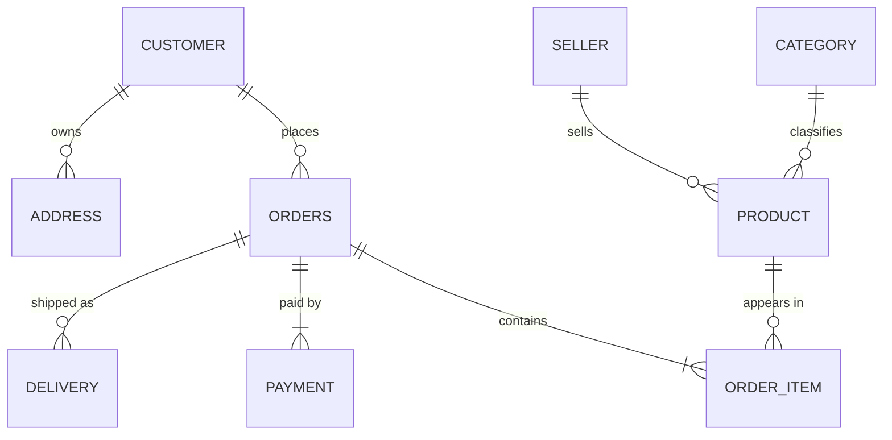
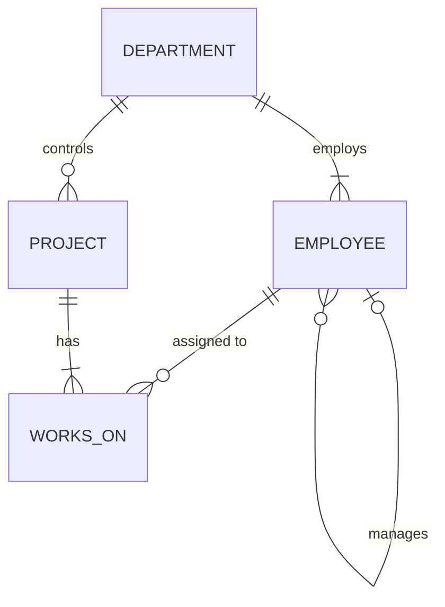

<div align="center">


&nbsp;&nbsp;&nbsp;&nbsp;&nbsp;&nbsp;&nbsp;&nbsp;


<br/><br/>


<br/>


<a href="#student-details"></a>
<a href="#experiments"></a>
<a href="#repository-structure"></a>
<a href="#getting-started"></a>
<a href="#databases-used"></a>
<a href="#concepts-covered"></a>

</div>


## Student Details

<div align="center">

<table>
<tr>
<th align="left">Name</th><td><b>Iqra Khan</b></td>
<td rowspan="8" align="center" valign="middle" width="200">
<br/><br/>

</td>
</tr>
<tr><th align="left">UID</th><td><code>25LBCS3306</code></td></tr>
<tr><th align="left">Program</th><td>BTech CSE (AIML) – Microsoft</td></tr>
<tr><th align="left">Section</th><td>B</td></tr>
<tr><th align="left">Group</th><td>A</td></tr>
<tr><th align="left">Subject Name</th><td>Database Management System</td></tr>
<tr><th align="left">Subject Code</th><td><code>25CSH-210</code></td></tr>
<tr><th align="left">Provided by</th><td>Microsoft and ByteXL</td></tr>
</table>

</div>

> [!NOTE]
> These experiments are **Group A** work, shared between the group's members as permitted by the instructor.


## About

This repository contains my **DBMS lab experiments**. Each experiment has:

- a **lab record** (`Exp_N.md`) with the aim, theory, implementation, output and result
- a **runnable SQL script** that reproduces every output shown in the record

All queries were executed on **MySQL 8.0**, and the outputs in each record are copied from real runs. The diagrams are written in **Mermaid**, so GitHub renders them directly in the browser.


## Experiments

| No. | Experiment | Key Topics | Lab Record | SQL Script |
|:---:|---|---|:---:|:---:|
|  | **ER Diagram:** Indian E-Commerce Platform | Entities, keys, composite and multi-valued attributes, weak entities, specialization, participation constraints | [Exp_1.md](Exp_1.md) <br/> [Exp_1.pdf](Exp_1.pdf) | — |
|  | **ER to Relational Schema** | `CREATE TABLE`, PK / FK, `NOT NULL`, `UNIQUE`, `CHECK`, `ON DELETE CASCADE / SET NULL`, referential integrity violations | [Exp_2.md](Exp_2.md) <br/> [Exp_2.pdf](Exp_2.pdf) | [ecommerce_schema.sql](ecommerce_schema.sql) |
|  | **Employee–Department–Project Queries** | Selection, projection, aggregates, `GROUP BY`, `HAVING`, `CASE`, `ORDER BY` | [Exp_3.md](Exp_3.md) | [company_queries.sql](company_queries.sql) |
|  | **Joins, Subqueries and EXPLAIN** | `INNER` / `LEFT` / self / 3-way joins, correlated subqueries, `EXISTS`, simulated `INTERSECT` and `EXCEPT`, execution plans | [Exp_4.md](Exp_4.md) | [joins_subqueries.sql](joins_subqueries.sql) |
|  | **Views and Recursive CTEs** | Salary summary and hierarchy views, view updatability, `WITH CHECK OPTION`, `WITH RECURSIVE` reporting chains | [Exp_5.md](Exp_5.md) | [views_recursive_cte.sql](views_recursive_cte.sql) |
|  | **Stored Procedures and Triggers** | `transfer_employee` procedure, `SIGNAL` / `RESIGNAL`, error handlers, salary-validation and audit triggers, edge cases | [Exp_6.md](Exp_6.md) | [procedures_triggers.sql](procedures_triggers.sql) |
|  | **Functional Dependencies and Normalization** | UNF → 1NF → 2NF → 3NF → BCNF, `JSON_TABLE` flattening, lossless-join and dependency-preservation verification via `EXCEPT` | [Exp_7.md](Exp_7.md) <br/> [Exp_7.pdf](Exp_7.pdf) | [normalization.sql](normalization.sql) |
|  | **Banking Transactions and Isolation Levels** | `BEGIN`/`COMMIT`/`ROLLBACK`/`SAVEPOINT`, partial-failure simulation, dirty/non-repeatable/phantom reads across two sessions | [Exp_8.md](Exp_8.md) <br/> [Exp_8.pdf](Exp_8.pdf) | [banking_transactions.sql](banking_transactions.sql) |
|  | **Railway Booking: Indexing** | 6,000-row dataset, single vs composite indexes, `EXPLAIN ANALYZE` before/after benchmarks | [Exp_9.md](Exp_9.md) <br/> [Exp_9.pdf](Exp_9.pdf) | [railway_indexing.sql](railway_indexing.sql) |
|  | **Large-Scale Query Optimization** | 12,000-row dataset, 5 slow-query anti-patterns fixed by indexing and query rewriting, `EXPLAIN ANALYZE` comparisons | [Exp_10.md](Exp_10.md) <br/> [Exp_10.pdf](Exp_10.pdf) | [query_optimization.sql](query_optimization.sql) |


## Repository Structure

```
DBMS-Lab/
│
├── README.md                    ← you are here
├── assets/                      ← logos, banners and colour rules
│
├── Exp_1.md                     ← ER diagram (Mermaid)
├── Exp_1.pdf                    ← ER diagram (handmade)
├── Exp_2.md                     ← Relational schema and constraints
├── Exp_2.pdf                    ← Relational schema and constraints (handmade)
├── Exp_3.md                     ← Basic SQL queries
├── Exp_4.md                     ← Joins, subqueries, EXPLAIN
├── Exp_5.md                     ← Views and recursive CTEs
├── Exp_6.md                     ← Procedures and triggers
├── Exp_7.md                     ← Functional dependencies and normalization
├── Exp_8.md                     ← Banking transactions and isolation levels
├── Exp_9.md                     ← Railway booking: indexing
├── Exp_10.md                    ← Large-scale query optimization
│
├── ecommerce_schema.sql         ← Exp 2  (creates ecommerce_db)
├── company_queries.sql          ← Exp 3  (creates company_db, used by Exp 4–6)
├── joins_subqueries.sql         ← Exp 4
├── views_recursive_cte.sql      ← Exp 5
├── procedures_triggers.sql      ← Exp 6
├── normalization.sql            ← Exp 7  (creates sales_normalization_db)
├── banking_transactions.sql     ← Exp 8  (creates bank_db)
├── railway_indexing.sql         ← Exp 9  (creates railway_db)
└── query_optimization.sql       ← Exp 10 (creates retail_orders_db)
```


## Getting Started

### Prerequisites

- **MySQL Server 8.0.31 or later** (needed for native `INTERSECT` / `EXCEPT` in Exp 4)
- MySQL command-line client or **MySQL Workbench**

### Clone the repository

```bash
git clone https://github.com/<your-username>/<repository-name>.git
cd <repository-name>
```

### Run the experiments

```bash
# Experiment 2: e-commerce database (independent)
mysql -u root -p -t --force < ecommerce_schema.sql

# Experiment 3: creates company_db. Run this BEFORE Experiments 4, 5 and 6
mysql -u root -p -t < company_queries.sql

# Experiments 4–6 run on company_db
mysql -u root -p -t          < joins_subqueries.sql
mysql -u root -p -t --force  < views_recursive_cte.sql
mysql -u root -p -t --force  < procedures_triggers.sql

# Experiments 7-10 are self-contained (each creates and drops its own database)
mysql -u root -p -t          < normalization.sql
mysql -u root -p -t --force  < banking_transactions.sql   # Section 5 (2-session demo) is run interactively
mysql -u root -p -t          < railway_indexing.sql
mysql -u root -p -t --force  < query_optimization.sql
```

> [!CAUTION]
> `--force` keeps the script running after errors that are **intentional**. Experiments 2, 5, 6, 8 and 10 deliberately trigger constraint, view, trigger and application-level violations to demonstrate them.

> [!TIP]
> Experiment 6 changes employee data. To start again from clean data, re-run `company_queries.sql`.


## Databases Used

### 1. `ecommerce_db`: Indian e-commerce platform (Exp 1–2)



**16 tables:** customers with multiple phone numbers and saved addresses; sellers with GSTIN and PAN; products specialised into Electronics, Clothing, Book and Grocery; orders, UPI / Card / COD payments, and deliveries through Indian courier partners.

### 2. `company_db`: Employee–Department–Project (Exp 3–6)



| Table | Rows | Description |
|---|:---:|---|
| `department` | 5 | Engineering, HR, Finance, Marketing, Operations |
| `employee` | 32 | Indian employees with a manager hierarchy (self-reference) |
| `project` | 8 | e.g. UPI Payment Gateway, GST Compliance Automation, Diwali Festive Campaign |
| `works_on` | 40 | M : N assignments with weekly hours and role |

### 3. `sales_normalization_db`: Denormalized Sales register (Exp 7)

A 10-sale / 19-line-item register, taken step by step from **UNF** (a repeating `products_ordered` JSON group) to **BCNF**: `customer`, `store`, `salesperson`, `product`, `sales_header_3nf`, `sale_item`.

### 4. `bank_db`: Bank accounts (Exp 8)

| Table | Rows | Description |
|---|:---:|---|
| `account` | 5 (+2 added live) | Savings/current accounts with a `CHECK (balance >= 0)` constraint |
| `transaction_log` | grows with each transfer | Audit trail of successful and failed transfers |

### 5. `railway_db`: Railway bookings (Exp 9)

| Table | Rows | Description |
|---|:---:|---|
| `train` | 40 | Reference list of trains |
| `railway_booking` | 6,000 | Generated bookings, indexed by PNR and by `(train_id, journey_date)` |

### 6. `retail_orders_db`: Retail orders (Exp 10)

| Table | Rows | Description |
|---|:---:|---|
| `orders` | 12,000 | Generated orders used to reproduce and fix 5 classic slow-query patterns |


## Concepts Covered

<table>
<tr>
<td valign="top" width="50%">

$\color{#9A1750}{\textsf{Data Modelling}}$
- [x] ER diagrams and notation
- [x] Composite, multi-valued and derived attributes
- [x] Weak entities and identifying relationships
- [x] Specialization (disjoint, partial)
- [x] Participation and cardinality constraints
- [x] ER-to-relational mapping

$\color{#E76F51}{\textsf{Constraints and Integrity}}$
- [x] Primary, foreign and unique keys
- [x] `NOT NULL` and `CHECK`
- [x] `ON DELETE CASCADE / SET NULL / RESTRICT`
- [x] Referential integrity violations

$\color{#2A9D8F}{\textsf{Querying}}$
- [x] Selection, projection and `DISTINCT`
- [x] Aggregates, `GROUP BY`, `HAVING`
- [x] `CASE` expressions and `ORDER BY`

</td>
<td valign="top" width="50%">

$\color{#264653}{\textsf{Advanced Queries}}$
- [x] Inner, outer, self and multi-table joins
- [x] Correlated subqueries
- [x] `EXISTS` / `NOT EXISTS` and relational division
- [x] `INTERSECT` and `EXCEPT` (native and simulated)

$\color{#6D597A}{\textsf{Query Optimisation}}$
- [x] `EXPLAIN`, `EXPLAIN FORMAT=TREE`, `EXPLAIN ANALYZE`
- [x] Indexes and access types
- [x] Semi-join and anti-join plans

$\color{#9C6610}{\textsf{Database Programming}}$
- [x] Views and view updatability
- [x] `WITH CHECK OPTION` (LOCAL / CASCADED)
- [x] Recursive CTEs
- [x] Stored procedures and transactions
- [x] `SIGNAL`, `RESIGNAL`, `GET DIAGNOSTICS`
- [x] `BEFORE` / `AFTER` triggers and audit logging

$\color{#3D405B}{\textsf{Normalization}}$
- [x] Functional dependencies and candidate keys
- [x] UNF → 1NF → 2NF → 3NF → BCNF, step by step
- [x] Lossless-join verification (`EXCEPT`)
- [x] Dependency-preservation verification
- [x] Update anomalies in denormalized designs

$\color{#E63946}{\textsf{Transactions and Concurrency}}$
- [x] `BEGIN`/`COMMIT`/`ROLLBACK`/`SAVEPOINT`
- [x] Partial failure and atomicity
- [x] Isolation levels (`READ UNCOMMITTED` → `SERIALIZABLE`)
- [x] Dirty read, non-repeatable read, phantom read (two-session demos)

$\color{#1D3557}{\textsf{Indexing and Optimization}}$
- [x] Single-column and composite (multi-column) indexes
- [x] `EXPLAIN` / `EXPLAIN ANALYZE`, `Handler_read_%` status counters
- [x] Sargable rewrites, `FULLTEXT` search, index merge / `UNION`
- [x] Correlated subquery → derived-table `JOIN` rewrite
- [x] Eliminating filesort with an `ORDER BY`-supporting index

</td>
</tr>
</table>


## Tools and Technologies

| Tool | Purpose |
|---|---|
|  | Database server used for every experiment |
|  | Running scripts and viewing results |
|  | ER and flow diagrams rendered by GitHub |
|  | Version control and hosting the lab records |


<div align="center">


&nbsp;&nbsp;&nbsp;


**Iqra Khan** · UID `25LBCS3306` · Section B · Group A

<sub>Database Management System (25CSH-210) · BTech CSE (AIML) – Microsoft · provided by Microsoft and ByteXL</sub>

</div>
